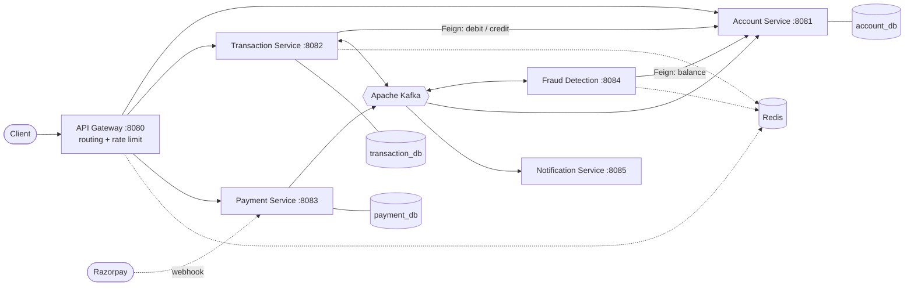
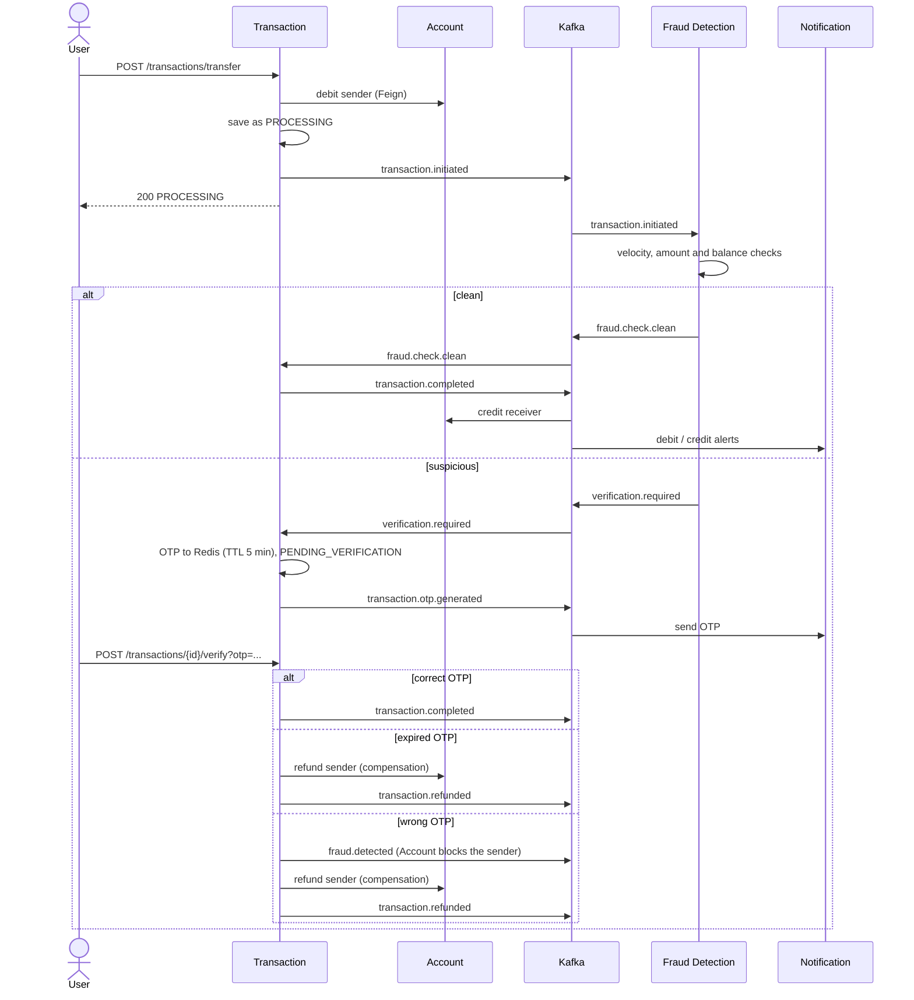
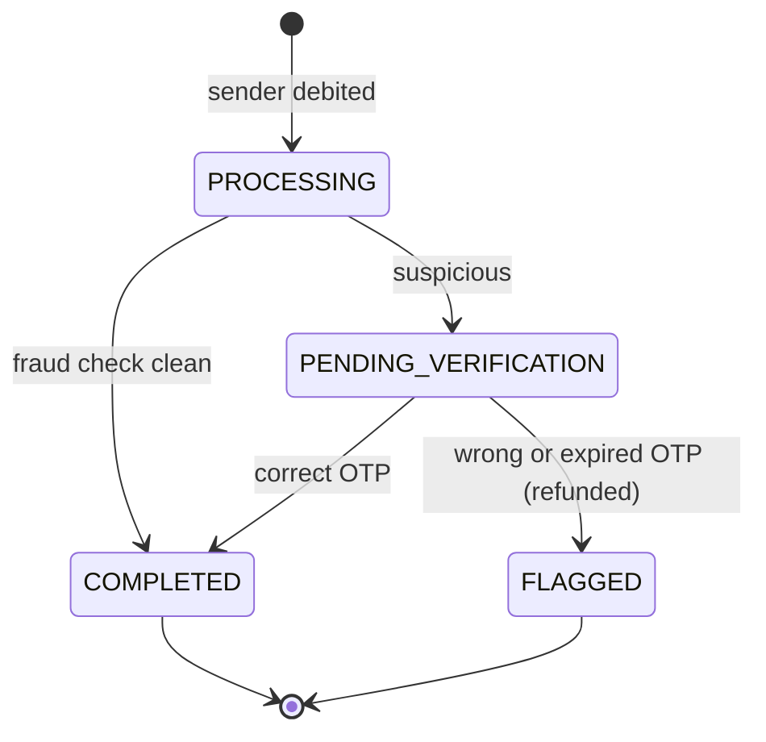

# Digital Banking System

**Event-driven banking backend built with Spring Boot microservices, Apache Kafka and Redis.**


Money transfers run as a **choreography-based Saga**. Six services coordinate through Kafka events with no central coordinator.
Every transfer is screened by a **Redis-backed fraud engine**. Suspicious transfers need **OTP verification**, and failed
verification triggers **compensating transactions**: an automatic refund, plus an account block when the wrong OTP is entered.

---

## Features

- **6 independently deployable microservices** behind a single API Gateway
- **Saga pattern with compensation**: no distributed transactions, and failed transfers are refunded automatically
- **Real-time fraud detection** with three rules: transfer velocity, abnormal amount, and balance ratio
- **OTP step-up verification** using Redis keys that expire after 5 minutes
- **Rate limiting at the gateway** with a Redis token bucket for each client IP
- **Razorpay integration** for deposits: order creation and webhook handling
- **Event-driven notifications** for debit/credit, OTP, refund, fraud and payment events
- **One-command local setup** with Docker Compose

---

## Architecture



| Service | Port | Responsibility | Storage |
|---|---|---|---|
| `api-gateway` | 8080 | Single entry point, path-based routing, rate limiting | Redis |
| `account-service` | 8081 | Accounts, balances, debit/credit, blocking | MySQL |
| `transaction-service` | 8082 | Transfers, saga steps, OTP verification, compensation | MySQL, Redis |
| `payment-service` | 8083 | Razorpay orders and webhooks | MySQL |
| `fraud-detection-service` | 8084 | Fraud rules on every transfer | Redis |
| `notification-service` | 8085 | Consumes events and sends alerts | — |

Each service owns its own database (**database-per-service**). Services talk **synchronously** through OpenFeign when they
need an immediate answer, such as debiting a balance, and **asynchronously** through Kafka for everything else.

---

## Transfer flow (Saga)



### Transaction states



Consumers only move a transaction forward if it is still in the expected state, so a Kafka message delivered twice is
handled safely (**idempotent**).

---

## Fraud detection rules

| Rule | Condition | Redis implementation |
|---|---|---|
| Velocity | More than **5** transfers in **60 s** | `INCR fraud:velocity<acc>` + `EXPIRE 60` |
| Abnormal amount | Amount > **3×** the account's average | `GET` / `SET fraud:avg_amount<acc>` |
| Balance ratio | Amount > **90%** of current balance | balance fetched from Account Service |

Thresholds can be changed in `fraud-detection-service/src/main/resources/application.yml`.

---

## Kafka topics

| Topic | Producer | Consumers |
|---|---|---|
| `transaction.initiated` | Transaction | Fraud Detection |
| `fraud.check.clean` | Fraud Detection | Transaction |
| `verification.required` | Fraud Detection | Transaction |
| `transaction.otp.generated` | Transaction | Notification |
| `transaction.completed` | Transaction | Account, Notification |
| `transaction.refunded` | Transaction | Notification |
| `fraud.detected` | Transaction | Account, Notification |
| `payment.completed` | Payment | Notification |
| `payment.failed` | Payment | Notification |

Each service has its own **consumer group**, so every subscribing service receives its own copy of each event.
Messages are JSON, and each consumer reads them as a plain `Map`, so services never share Java classes.

## Redis usage

| Used by | Key | TTL | Purpose |
|---|---|---|---|
| API Gateway | `request_rate_limiter.{ip}.*` | auto | Token bucket shared across gateway instances |
| Transaction | `verification:otp<txId>` | 5 min | OTP storage; the TTL is the OTP timeout |
| Fraud Detection | `fraud:velocity<acc>` | 60 s | Transfers-per-minute counter |
| Fraud Detection | `fraud:avg_amount<acc>` | — | Running average transfer amount |

Rate limits are **10 requests/s with bursts of 20** for accounts and transactions, and **5/s with bursts of 10** for payments.
Clients that go over the limit get `429 Too Many Requests`.

---

## API reference

Every request goes through the gateway at `http://localhost:8080`.

| Method | Endpoint | Description |
|---|---|---|
| `POST` | `/api/v1/accounts` | Create an account |
| `GET` | `/api/v1/accounts/{accountNumber}` | Get account details |
| `GET` | `/api/v1/accounts/{accountNumber}/balance` | Get balance |
| `PUT` | `/api/v1/accounts/{accountNumber}/block` | Block an account |
| `POST` | `/api/v1/transactions/transfer` | Start a transfer |
| `GET` | `/api/v1/transactions/{transactionId}` | Get transaction status |
| `GET` | `/api/v1/transactions/account/{accountNumber}` | Transaction history |
| `POST` | `/api/v1/transactions/{transactionId}/verify?otp=` | Verify OTP |
| `POST` | `/api/v1/payments/create-order` | Create a Razorpay order |
| `POST` | `/api/v1/payments/webhook` | Razorpay webhook receiver |

<details>
<summary>Example requests</summary>

```bash
# Create an account
curl -X POST localhost:8080/api/v1/accounts -H "Content-Type: application/json" \
  -d '{"accountHolderName":"Alice","email":"alice@test.com","phone":"9999999991","accountType":"SAVINGS","initialDeposit":10000}'

# Transfer
curl -X POST localhost:8080/api/v1/transactions/transfer -H "Content-Type: application/json" \
  -d '{"senderAccountNumber":"<A>","receiverAccountNumber":"<B>","amount":1000,"description":"rent"}'

# Check status
curl localhost:8080/api/v1/transactions/<txId>

# Verify OTP (the OTP appears in: docker logs notification-service)
curl -X POST "localhost:8080/api/v1/transactions/<txId>/verify?otp=<otp>"

# Create a Razorpay order
curl -X POST localhost:8080/api/v1/payments/create-order -H "Content-Type: application/json" \
  -d '{"accountNumber":"<A>","amount":500}'
```
</details>

---

## Getting started

**Prerequisites:** JDK 17, Maven 3.9+, Docker Desktop

```bash
# 1. Clone
git clone https://github.com/sujaypande/Digital-Banking-System.git
cd Digital-Banking-System

# 2. Configure secrets (Razorpay test keys are fine)
cp .env.example .env

# 3. Build the jars
for s in account-service transaction-service payment-service fraud-detection-service notification-service api-gateway; do
  (cd $s && mvn clean package -DskipTests)
done

# 4. Start everything (MySQL, Redis, Kafka, Zookeeper and the 6 services)
docker compose up -d --build

# 5. Check health
curl localhost:8081/actuator/health
```

### Testing the fraud flows

| Scenario | How to trigger | Expected result |
|---|---|---|
| Clean transfer | First small transfer from an account | `COMPLETED`, receiver credited |
| Abnormal amount | Transfer more than 3× the previous amount | `PENDING_VERIFICATION`, OTP in the notification logs |
| Wrong OTP | Verify with an incorrect OTP | `FLAGGED`, sender refunded, account `BLOCKED` |
| Expired OTP | `docker exec redis redis-cli del verification:otp<txId>`, then verify | `FLAGGED`, sender refunded |
| Velocity | 6 transfers from one account within 60 s | 6th transfer needs an OTP |
| Rate limit | 40 quick requests to the gateway | `429 Too Many Requests` |

### Looking inside

```bash
docker logs -f notification-service                                            # alerts and OTPs
docker exec redis redis-cli keys '*'                                           # Redis keys
docker exec kafka kafka-topics --bootstrap-server localhost:9092 --list        # Kafka topics
docker exec kafka kafka-console-consumer --bootstrap-server localhost:9092 \
  --topic transaction.completed --from-beginning                               # events on a topic
```

---

## Project structure

```
.
├── api-gateway/               # Spring Cloud Gateway, routes and Redis rate limiter
├── account-service/           # Accounts, balances, Kafka consumers (credit, block)
├── transaction-service/       # Transfers, saga steps, OTP, compensation
├── payment-service/           # Razorpay orders and webhooks
├── fraud-detection-service/   # Fraud rules on Redis
├── notification-service/      # Event-driven alerts
├── docker-compose.yml         # Infrastructure and all services
└── .env.example               # Required environment variables
```

---

## Design decisions

- **Choreography Saga instead of 2PC.** Each service owns its data, so a single ACID transaction can't cover a transfer.
  Each step commits locally, and failures are undone with compensating actions.
- **The sender is debited first and the receiver is credited last.** Money can't be spent twice while a check is
  pending, and the receiver only gets funds after every check passes.
- **The user gets a response right away.** The fraud check runs in the background, so the transfer API isn't slowed by it.
- **Redis TTLs instead of cleanup jobs.** OTP expiry and velocity windows are simply Redis keys expiring.


